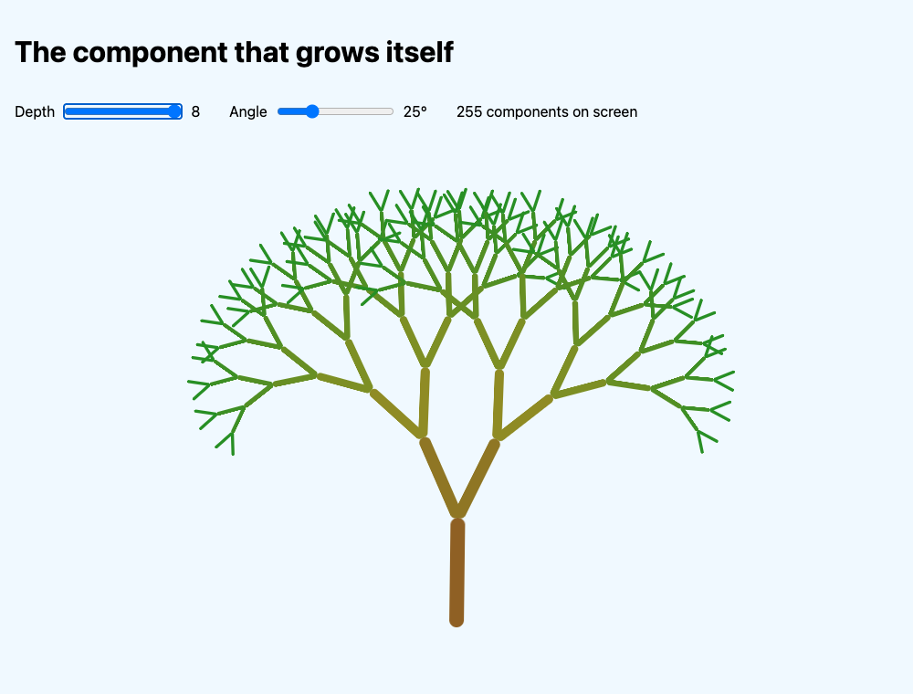

# Lit – The component that grows itself

What happens when a component renders **itself**?

In this demo we build **one** Lit component, `<fractal-tree>`. It draws a single branch, then renders two smaller copies of itself on top of that branch. Those copies do the same, and so do their copies… until a `depth` property reaches 1. The result is a living, swaying fractal tree. A slider changes the depth from 1 to 8, and the tree grows or shrinks in real time.



It's a slightly nerdy showcase of **component composition**: a component that contains instances of itself. React and Vue can technically do this too. But here every branch is a **real HTML element** with its own Shadow DOM, so you can inspect it in DevTools, style it with CSS and drop it in any page. And it takes surprisingly little code: the whole component is about 85 lines, and most of those are CSS.

The solutions for every step are in the `step…` folders of this demo.

See also: https://lit.dev/docs/

> ℹ️ This demo was written for **Lit 3**. Just like demo 02, Lit is loaded straight from its CDN, so there's no bundler and no build step.

Read these pages of the Lit docs before you start (or keep them open next to this guide):

- [Reactive properties](https://lit.dev/docs/components/properties/)
- [Expressions](https://lit.dev/docs/templates/expressions/) (especially property bindings with `.`)
- [Conditionals](https://lit.dev/docs/templates/conditionals/) (`nothing`)
- [Styles](https://lit.dev/docs/components/styles/) (`:host` and inheritance)

## Table of contents

- [What you'll learn](#what-youll-learn)
- [Prerequisites](#prerequisites)
- [Getting started](#getting-started)
- [Step 1: One branch](#step-1-one-branch)
- [Step 2: A component that renders itself](#step-2-a-component-that-renders-itself)
- [Step 3: Sliders](#step-3-sliders)
- [Step 4: Bring it to life](#step-4-bring-it-to-life)
- [Why this fits Web Components so well](#why-this-fits-web-components-so-well)
- [Going further](#going-further)

## What you'll learn

- **Recursive components**: a component that uses its own tag in its template, and the **stop condition** that keeps it from running forever.
- Passing numbers down with a **property binding** (`.depth=${…}`).
- How CSS `transform`s **add up** when elements are nested. That's what makes the fractal.
- How **CSS custom properties** (`--angle`) flow through every shadow root, and why that lets you change 255 components **without a single re-render**.
- How Lit **reuses** existing elements when a property changes, and how you can see that with an animation.
- The cost of recursion: every extra level **doubles** the number of components.

## Prerequisites

- You finished [demo 02](../demo-02/README.md), or you know how `LitElement`, `static properties`, `render()` and `html` work.
- A working Node.js installation (`node --version`).
- Chrome (or another modern browser) with DevTools.

## Getting started

Every step gets its own folder. At the end, your project looks like this:

```
├── fractal
│   ├── package.json
│   ├── step1-branch
│   │   ├── fractal-tree.js
│   │   ├── index.html
│   ├── step2-recursion
│   │   ├── fractal-tree.js
│   │   ├── index.html
│   ├── step3-sliders
│   │   ├── fractal-tree.js
│   │   ├── index.html
│   ├── step4-alive
│   │   ├── fractal-tree.js
│   │   ├── index.html
```

### Create the project

```bash
mkdir fractal
cd fractal
npm init -y
```

Open `package.json` and make the same two changes as in demo 02:

```diff
  "scripts": {
-    "test": "echo \"Error: no test specified\" && exit 1"
+    "dev": "npx serve ."
  },
  ...
-  "type": "commonjs"
+  "type": "module"
```

### Start the server

```bash
npm run dev
```

Leave this terminal running and open http://localhost:3000. Every step folder shows up there. Refresh the browser after every change.

> ⚠️ Don't double-click `index.html`. Browsers block ES modules on `file://` URLs, so you always need a (local) server.

## Step 1: One branch

A fractal is one simple shape, repeated. Our shape is a branch: a brown, rounded rectangle.

### Create the component

Create `step1-branch/fractal-tree.js`:

```js
import { LitElement, html, css } from 'https://cdn.jsdelivr.net/gh/lit/dist@3/core/lit-core.min.js';

class FractalTree extends LitElement {
  static properties = {
    depth: { type: Number },
  };

  static styles = css`
    :host {
      display: block;
      width: 16px;
      height: 120px;
    }

    .branch {
      width: 100%;
      height: 100%;
      background: #78350f;
      border-radius: 8px;
    }
  `;

  constructor() {
    super();
    this.depth = 1;
  }

  render() {
    return html`<div class="branch"></div>`;
  }
}

customElements.define('fractal-tree', FractalTree);
```

- `depth` is a public property: **how many levels** of branches this tree should have. We don't use it yet.
- `type: Number` matters. HTML attributes are always strings, so `depth="5"` arrives as the string `"5"`. `type: Number` tells Lit to turn it into the number `5`. Without it, `this.depth - 1` would still work (JavaScript converts), but `this.depth + 1` would give `"51"`.

### Use it in the page

Create `step1-branch/index.html`:

```html
<!doctype html>
<html lang="en">
  <head>
    <meta charset="UTF-8" />
    <title>Fractal tree – step 1</title>
    <script type="module" src="./fractal-tree.js"></script>
    <style>
      body {
        background: #f0f9ff;
        font-family: system-ui, sans-serif;
        margin: 0;
        padding: 16px;
      }

      .stage {
        display: flex;
        align-items: flex-end;
        justify-content: center;
        height: 540px;
        overflow: hidden;
      }
    </style>
  </head>
  <body>
    <h1>The component that grows itself</h1>
    <div class="stage">
      <fractal-tree depth="5"></fractal-tree>
    </div>
  </body>
</html>
```

The `.stage` places the tree at the **bottom center**, so it can grow upwards.

**What happens:** a single brown branch, standing up. Not very impressive yet.

## Step 2: A component that renders itself

Now the magic. Copy the `step1-branch` folder to `step2-recursion`.

### Render two smaller copies

In `fractal-tree.js`, import `nothing` and change `render()`:

```diff
- import { LitElement, html, css } from 'https://cdn.jsdelivr.net/gh/lit/dist@3/core/lit-core.min.js';
+ import { LitElement, html, css, nothing } from 'https://cdn.jsdelivr.net/gh/lit/dist@3/core/lit-core.min.js';
```

```diff
  render() {
-    return html`<div class="branch"></div>`;
+    return html`
+      <div class="branch">
+        ${this.depth > 1
+          ? html`
+              <fractal-tree class="left" .depth=${this.depth - 1}></fractal-tree>
+              <fractal-tree class="right" .depth=${this.depth - 1}></fractal-tree>
+            `
+          : nothing}
+      </div>
+    `;
  }
```

Read this slowly. Inside the template of `<fractal-tree>`, we use… `<fractal-tree>`. Each branch renders two child trees, and each child has **one level less** (`this.depth - 1`).

- `.depth=${…}` is a **property binding** (with a dot). We pass a real number, so no string conversion is needed.
- `this.depth > 1 ? … : nothing` is the **stop condition** (in recursion it's called the *base case*). A tree with depth 1 is just a branch without children: a leaf.

> ⚠️ **Never forget the stop condition.** Without `this.depth > 1`, every tree renders two more trees, forever. The browser keeps creating elements until the tab freezes. If you want to see it happen, save your work first and be ready to close the tab.

How many components is that? Depth 1 is 1 branch. Depth 2 is 1 + 2 = 3. Depth 3 is 1 + 2 + 4 = 7. In general: **2<sup>depth</sup> − 1**. Our `depth="5"` gives **31** `<fractal-tree>` elements.

### Place the children on top of the branch

If you refresh now, you see… still one branch. The 30 other trees are there (check the Elements panel), but they're all stacked on the same spot. Add this CSS:

```diff
    .branch {
+      position: relative;
      width: 100%;
      height: 100%;
      background: #78350f;
      border-radius: 8px;
    }
+
+    fractal-tree {
+      position: absolute;
+      bottom: 100%;
+      left: 0;
+      transform-origin: bottom center;
+    }
+
+    .left {
+      transform: rotate(calc(-1 * var(--angle, 25deg))) scale(0.8);
+    }
+
+    .right {
+      transform: rotate(var(--angle, 25deg)) scale(0.8);
+    }
```

Line by line:

- `position: absolute; bottom: 100%` puts the **bottom** of each child tree at the **top** of its parent branch. That's where the branch splits.
- `transform-origin: bottom center` makes the child rotate around its **foot**, like a real branch on a joint. (The default is the center, which would make the branches float away.)
- `.left` rotates to the left, `.right` rotates to the right, and both are `scale(0.8)`: 80% of the size of their parent.
- `var(--angle, 25deg)` reads the CSS custom property `--angle`. Nobody sets it yet, so the fallback `25deg` is used. We'll control it with a slider in the next step.

> ℹ️ `fractal-tree { … }` in this stylesheet only targets the **child** trees inside this component's shadow root. It can't reach the root `<fractal-tree>` in the page. `:host` is how a component styles **itself**.

Here comes the trick that makes it a fractal: **transforms add up**. A child is rotated and scaled **relative to its parent**, which is already rotated and scaled relative to **its** parent. So the fourth level is `0.8 × 0.8 × 0.8 = 0.51` times the size of the trunk, and its angle is the sum of all the angles on the way up. We never calculate a single coordinate ourselves. The browser does it all.

**What happens:** a tree with 5 levels appears, all in brown. Change `depth="5"` in the HTML to `2`, `8` or `1` and refresh.

**Try it yourself:** in DevTools, open the Elements panel and expand `<fractal-tree>` → `#shadow-root` → `<fractal-tree class="left">` → `#shadow-root` → … You'll find the component inside itself, again and again. Hover over one: the browser highlights that branch **and** everything that grows from it.

## Step 3: Sliders

Changing the HTML and refreshing is slow. Let's add two sliders: one for the depth and one for the angle.

Copy `step2-recursion` to `step3-sliders`. `fractal-tree.js` stays **exactly the same**.

### Add the controls

In `index.html`, add the controls above the stage:

```diff
    <h1>The component that grows itself</h1>
+
+    <div class="controls">
+      <label>
+        Depth
+        <input id="depth" type="range" min="1" max="8" value="5" />
+        <output id="depth-value">5</output>
+      </label>
+      <label>
+        Angle
+        <input id="angle" type="range" min="0" max="90" value="25" />
+        <output id="angle-value">25°</output>
+      </label>
+      <p><output id="count">31</output> components on screen</p>
+    </div>
+
    <div class="stage">
```

And some layout CSS in the `<style>` block:

```diff
+      .controls {
+        display: flex;
+        flex-wrap: wrap;
+        gap: 16px 32px;
+      }
+
+      label {
+        display: flex;
+        align-items: center;
+        gap: 8px;
+      }
+
      .stage {
```

### Connect them to the tree

At the bottom of the `<body>`, add a script:

```html
<script type="module">
  const tree = document.querySelector('fractal-tree');
  const depthInput = document.querySelector('#depth');
  const angleInput = document.querySelector('#angle');

  depthInput.addEventListener('input', () => {
    const depth = depthInput.valueAsNumber;
    tree.depth = depth;
    document.querySelector('#depth-value').textContent = depth;
    document.querySelector('#count').textContent = 2 ** depth - 1;
  });

  angleInput.addEventListener('input', () => {
    tree.style.setProperty('--angle', `${angleInput.value}deg`);
    document.querySelector('#angle-value').textContent = `${angleInput.value}°`;
  });
</script>
```

The two sliders change the tree in two **completely different** ways, and that's the most interesting part of this demo:

| Slider | What it changes                    | What happens                                                                                   |
| ------ | ---------------------------------- | ---------------------------------------------------------------------------------------------- |
| Depth  | The **reactive property** `depth`  | Lit re-renders. Every tree passes the new depth to its children, all the way down to the leaves |
| Angle  | The **CSS custom property** `--angle` | **No re-render at all.** The browser only recalculates the styles                           |

Why does the angle work? We set `--angle` only on the **root** `<fractal-tree>` in the page. Then how do 254 components deep inside nested shadow roots know about it?

Because **CSS custom properties are inherited**, and inheritance goes **through** Shadow DOM. Remember [demo 02](../demo-02/README.md#why-all-initial-on-host): Shadow DOM blocks **selectors** from the page, but inherited values like `color` still flow in. Custom properties inherit the same way. So `--angle` flows from the root into every shadow root, and every `var(--angle, 25deg)` picks it up. That's also exactly how design systems theme Web Components from the outside.

**What happens:** drag the **Depth** slider: the tree grows and shrinks, and the counter shows how many components are on screen. Drag the **Angle** slider: at 0° the tree is a straight stick, at 90° it becomes a pattern of right angles (an "H-tree").

**Try it yourself:** prove that the angle slider doesn't re-render. Add `console.count('render');` as the first line of `render()` in `fractal-tree.js`, refresh and clear the console.

- Drag the **Angle** slider around: the counter doesn't move. 0 renders.
- Move **Depth** from 5 to 6: 63 renders. The 31 existing trees each re-render once, because their `depth` changed, and 32 new leaves render for the first time.

Remove the `console.count` afterwards.

> 💡 Want to count the components yourself? `document.querySelectorAll('fractal-tree')` only finds **1**, because the others are hidden in shadow roots. Paste this into the console instead:
>
> ```js
> const count = (el) => 1 + [...el.shadowRoot.querySelectorAll('fractal-tree')].reduce((n, child) => n + count(child), 0);
> count(document.querySelector('fractal-tree'));
> ```
>
> Recursion to count a recursive component. 🙂

## Step 4: Bring it to life

Our tree works, but it's brown and stiff. In this final step we add three things:

1. **Color** that goes from brown (trunk) to green (leaves).
2. New branches that **grow** out of the tips.
3. A gentle **sway**, as if there's wind.

Copy `step3-sliders` to `step4-alive`. This time only `fractal-tree.js` changes.

### Color by depth

The trunk has the highest depth, and the leaves always have depth 1. We turn that number into a **hue** (a color on the color wheel) and pass it to the CSS with a custom property:

```diff
-      <div class="branch">
+      <div class="branch" style="--hue: ${130 - this.depth * 12}">
```

```diff
    .branch {
      position: relative;
      width: 100%;
      height: 100%;
-      background: #78350f;
+      background: hsl(var(--hue) 60% 35%);
      border-radius: 8px;
+      transition: background 0.4s;
    }
```

A leaf (depth 1) gets hue `118`, which is green. The trunk at depth 8 gets hue `34`, which is brown-orange. Everything in between fades from one to the other. When you move the depth slider, every branch gets a new depth, and `transition` makes the colors fade smoothly.

> ℹ️ `style="--hue: ${…}"` is a normal **attribute binding**. Lit only updates it when the value actually changes.

### Grow and sway

Add two animations to `.branch`:

```diff
    .branch {
      ...
      transition: background 0.4s;
+      transform-origin: bottom center;
+      animation:
+        grow 0.6s ease-out,
+        sway 5s ease-in-out infinite;
    }
+
+    @keyframes grow {
+      from {
+        scale: 1 0;
+      }
+    }
+
+    @keyframes sway {
+      25% {
+        rotate: -2deg;
+      }
+      75% {
+        rotate: 2deg;
+      }
+    }
+
+    @media (prefers-reduced-motion: reduce) {
+      .branch {
+        animation: none;
+      }
+    }
```

- `grow` starts the branch at a height of 0 (`scale: 1 0`) and grows it to full size. The children are **inside** `.branch`, so they grow along with it.
- `sway` rotates each branch a tiny bit, 2 degrees. But remember: **transforms add up**. At the tips, those 2 degrees are added 8 times, so the leaves move a lot more than the trunk, just like a real tree in the wind.
- We use the separate `scale` and `rotate` properties instead of `transform`. That way the two animations don't overwrite each other: `grow` only touches `scale`, `sway` only touches `rotate`.
- `prefers-reduced-motion` turns the animation off for people who set their operating system to reduce motion.

**What happens:** refresh the page. The tree grows out of the ground, level by level, and then starts to sway gently. Now drag the **Depth** slider up slowly…

### Only the new branches grow. Why?

When you go from depth 5 to 6, the **existing** branches don't replay their `grow` animation. Only the new leaves at the tips grow out. That's not something we programmed. It's Lit's rendering at work:

- The root tree re-renders with `.depth=${6 - 1}`. Lit sees the **same template** as last time, so it keeps the existing child elements and only updates their `depth` property.
- That goes on all the way down. Only the old leaves (depth 1 → 2) now render children for the first time, so only there are **new** `<div class="branch">` elements created.
- A CSS animation only plays when an element is created. Existing elements keep their animation state.

So the animation shows you exactly **which DOM elements Lit created** and which ones it reused.

> ℹ️ **Why doesn't shrinking animate?** When you lower the depth, Lit removes the leaves **immediately**. There's no element left to animate. Animating elements *out* is a lot harder: you have to keep them around until the animation has finished. See [Going further](#going-further).

🎉 One component, about 85 lines, up to 255 instances of itself on screen.

## Why this fits Web Components so well

- **Every branch is a real element.** You can inspect, hover, and style each one in DevTools, and `getAnimations()` works on each one.
- **Encapsulation per level.** Every tree has its own shadow root, so the `.left` and `.right` classes of one level can never clash with another level.
- **Theming through inheritance.** One custom property on the root controls every level, without passing anything down in JavaScript.
- **Portable.** `<fractal-tree depth="6">` works in plain HTML, in React, in Vue… anywhere you can write a tag.

## Going further

Finished early? Try one or more of these. There are no solutions for them.

### Nested squares

Make a second component, `<fractal-square>`, that renders **four** smaller copies of itself: one in each corner, at `scale(0.5)`. Give each level a different color. How many components are on screen at depth 6? (Tip: it's no longer 2<sup>depth</sup> − 1.)

### Pass the angle as a property

Make `angle` a reactive property instead of a CSS custom property, and pass it down with `.angle=${this.angle}`. Use `console.count('render')` again and compare: how many renders does one step of the angle slider cost now?

### A bit of chaos

Real trees aren't symmetrical. Give each branch a small random extra angle (for example between -8° and 8°), chosen **once** in the constructor. Why is it important to choose it in the constructor and not in `render()`?

### Smooth shrinking

Make the leaves shrink away before they're removed. One approach: keep rendering the children for a moment with a `shrinking` class that plays `grow` in reverse, and only lower the depth after the `animationend` event. Tip: look at the `updated()` lifecycle method.

### How deep can you go?

Set the slider's `max` to 12 (4 095 components) or 14 (16 383 components). Use the DevTools **Performance** panel to record a depth change. Where does the time go: in Lit's rendering, or in the browser's style and layout work?
